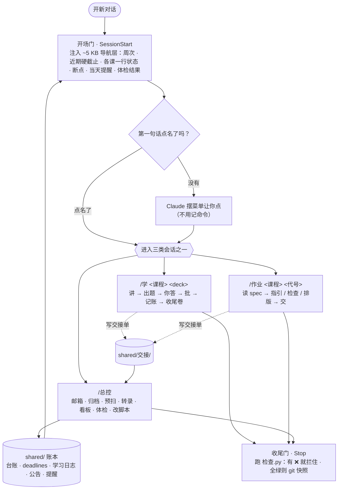

# claude-study-system

[English](README_en.md) · 中文

> 一套让 Claude Code **带着你一页一页学课件**的学习架构：
> hooks + slash commands + 一致性检查脚本 + 一份把教学规则写死的 `CLAUDE.md`。

作者读 CS 硕士的一个学期里，四门课全程用它跑：讲课件、出题批改、追 DDL、转录录音、出学习看板。
**这里是脱敏后的模板版** —— 课程材料、作业、成绩一律不在里面，示例数据是两门虚构课（`algorithms` / `networks`）。

---

## 它解决什么问题

让 Claude 当 tutor，最常见的毛病是：

| 毛病 | 这套架构怎么治 |
|---|---|
| 一口气讲十页，讲完不验证你懂没懂 | 一块 ≤ 5 页真内容；**完成 = 讲 + 你答 + 它批**，缺一件就要重讲 |
| 换个对话就忘了讲到哪 | 进度只记在账本里（`shared/lecture台账.md`），新对话从账本取，不靠记忆 |
| 凭印象报 DDL、算欠多少页 | 账本是唯一数据源；`导航.py` 每次现算周次和近期截止 |
| 嘴上答应的规则，下个对话就忘了 | 规则写进 `CLAUDE.md`；关键的几条由 **Stop hook 机械拦住**（有 ❌ 不许收尾）|
| 一个对话什么都干，上下文越来越肥 | **一个对话只做一件事**：学一份课件 / 做一份作业 / 杂活，三类分开 |
| 录音转录直接丢给你读 | 转录只当「配料」：讲到第 N 页才去对照那一段，老师口头说的考点当场标出来 |

核心思路一句话：**规则写进 `CLAUDE.md`，状态写进账本，靠 hook 和脚本把「Claude 记得」变成「机械拦住」。**

`shared/规则档案.md` 记着每条规则**为什么存在** —— 学生的原话、Claude 犯过的错、当时怎么处置的，按日期倒序。想知道某条规则从哪来，看那里。

---

## 架构



### 三类会话 · 写文件分区

| 类 | 起法 | 只许写 |
|---|---|---|
| **学习类** | `/学` · `/作业` | 自己那门课的目录 · `shared/学时记录.md`（只追加）· `shared/交接/`（回写账本的唯一通道）|
| **总控类** | `/总控` | `shared/` 的账本 · `.claude/` · `shared/工具/` · 各课目录 |

两类会话可以**同时开**：学习会话动不了共享账本，要改账本就写交接单，`/总控` 开场先把交接单清掉。这样两个对话不会互相覆盖。

### 三道门（hooks）

| 门 | 什么时候 | 干什么 | 能拦吗 |
|---|---|---|---|
| 开场门 `inject-context.sh` | 会话开始 | 注入导航层（`导航.py`）+ 当天提醒 + 体检摘要 | 只注入 |
| 消息门 `inject-time.sh` | 每条消息 | 当前时间 + 开讲 / 批改前必做的事 | 只注入 |
| 收尾门 `stop-check.sh` | 每回合结束 | 跑 `检查.py`，有 ❌ 就拦住；全绿 → 行动项审计 → git 快照 | ✅ |

`检查.py` 查的是账本之间的一致性：台账页数 vs PDF 真实页数、学时累计 vs 明细之和、引用的路径存不存在、交接单清没清，还有两把**凭证锁**（台账进度只能在「讲 + 答 + 批」都齐的回合里推进）。

### 学一份课件的流程

```
预扫摘要（没有就先跑 预扫.py）→ 对照表校对（没校对的页不许开讲）→ 把课件 PDF 发到右侧面板
→ 讲一块（≤ 5 页）→ 块中快测（客观题，选项带 (a)(b)(c)(d)）→ 你答 → 批改（先原样贴题干）→ 记账
→ …… → 一讲讲完出一份收尾卷（唯一测「英文写不写得出」的地方）
```

转录里老师说了、课件上没有的，讲到那一页时当场标出来：🔴 考点 · ⚪ 不考 · 💡 补充 · ⚠️ 易错。

---

## 快速开始

```bash
git clone https://github.com/Zemmeng/claude-study-system.git
cd claude-study-system
python3 shared/工具/导航.py      # 看开场门会注入什么
python3 shared/工具/检查.py      # 跑一致性检查
claude                           # 在这个目录下启动 Claude Code
```

示例数据里，`algorithms` 有一份 deck 讲完、一份讲了一半，`networks` 有一份讲完。开场会看到导航层和菜单，可以直接试 `/学 algorithms w02-L1`。

### 换成你自己的学期

1. **改 `shared/配置.json`** —— 课程 key（同时是目录名）、代码、中文名、别名、lecture / tute 时间。脚本全部从这里读课程列表。
2. **建课程目录**：照示例课的结构建 `<课程>/课件/ 字幕/ 笔记/ 作业/ …`，删掉 `algorithms/` `networks/` 两个示例。课件命名 `wNN-LN.pdf`。
3. **清空 `shared/` 账本里的示例行**（保留表头和顶部说明），`deadlines.md` 换成你的学期日历。
4. **改 `CLAUDE.md` 里「关于他」「他的作息」「他的课表」三节**（带 ✏️ 的地方）。文件里的「他」指学生本人，可以整体替换成「我」。
5. 跑 `python3 shared/工具/检查.py` 到全绿，然后 `claude`。

> ⚠️ **你自己的副本里会有课件、录音、作业 —— 别把它设成 public。** 课件和录音一般是学校的版权，作业代码很多课明文禁止分享。

---

## 依赖

| 必需 | 用途 |
|---|---|
| [Claude Code](https://claude.com/claude-code) | 本体 |
| Python ≥ 3.9 | 所有脚本（只用标准库）|
| `jq` | 开场门拼 JSON |
| `git` | 收尾门的快照和凭证锁 |
| poppler（`pdfinfo` `pdftotext` `pdftoppm`）| 数页数、预扫、把 PDF 渲染成图检查 |

| 可选 | 用途 |
|---|---|
| XeLaTeX | 出学习看板 PDF、排版作业 |
| whisper.cpp + ffmpeg | 录音离线转录（`shared/工具/转录.sh`）|
| Gmail connector | `/总控` 扫邮箱 |
| Claude Code 桌面版 | `对齐.py` 读其他对话的 transcript、会话列表；CLI 下这几步跳过 |

---

## 目录

```
CLAUDE.md                 常驻规则：会话类型 · 怎么讲 / 出题 / 批改 · 完成的定义 · 学术诚信 · 学生画像
.claude/
  settings.json           三道门的 hook 注册
  hooks/                  inject-context.sh · inject-time.sh · stop-check.sh
  commands/               /学 /作业 /总控 /next /week /drill /预扫
shared/
  配置.json               ⭐ 唯一要按自己学期改的配置
  lecture台账.md          ⭐ 页数 / 讲到哪 / 字幕 / 到场 —— 欠帐的唯一数据源
  deadlines.md            学期日历 + 时间线
  学习日志.md             当前状态 / 断点 / 反复犯的错
  学时记录.md             每次学完追加一行
  公告.md                 老师口头说的、公告、考试范围
  提醒.tsv                日期触发的提醒
  活动会话.tsv            谁开着 · 刚收尾了什么
  交接/                   学习会话回写账本的唯一通道
  工具手册.md             杂活怎么做：转录 · 截图 · 归档 · 预扫 · 邮箱 · LaTeX
  规则档案.md             每条规则为什么存在
  API笔记/                探过的工具 API（Canvas · Ed …），下次不用重探
  工具/                   导航.py · 检查.py · 预扫.py · 对齐.py · 转录.sh · md2pdf.py …
<课程>/                   示例：algorithms/ networks/
  CLAUDE.md               这门课的考核、hurdle、考试形式
  课件/  课件/_预扫/       PDF + 每份 deck 的机械事实（页数 · 页脚 offset · 续篇 · 前置警告）
  字幕/                   转录 + <deck>-对照.md（按课件页码切的转录索引）
  笔记/  收尾卷/  作业/  tute/  教材/  例卷/
  答题表达套件.md          把概念写成得分英文句的句式库
```

---

## 读的顺序

1. `CLAUDE.md` —— 全部规则
2. `shared/规则档案.md` —— 规则为什么长这样
3. `.claude/commands/学.md` —— 一个学习会话从开场到收尾的完整流程
4. `shared/工具/检查.py` —— 哪些规则被机械化了、怎么机械化的

## 已知限制

- 全中文，文件名也是中文（脚本没问题，终端需要 UTF-8）。
- `检查.py` 的正则是照这套账本格式写的，改账本格式要同步改脚本。
- 原来是给一个人用的，很多规则带着他的习惯（中午才起床、考卷是英文、默认不去 lecture）—— 当成例子看，按自己情况改。
- **它不帮你绕过课程的 AI 政策。** `CLAUDE.md` 里的规则是：每份作业按它自己的 spec 走；不允许 AI 的作业，最终交上去的东西由你自己完成。

## License

[MIT](LICENSE)
