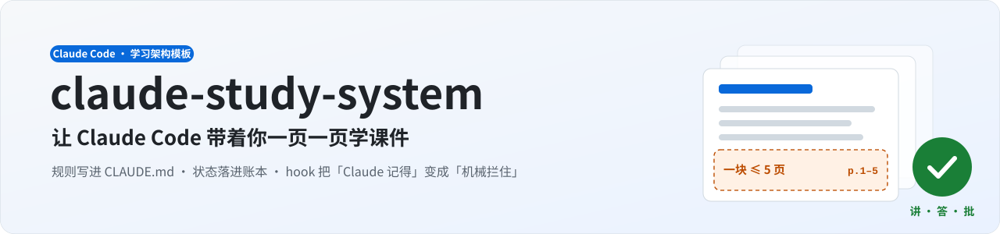
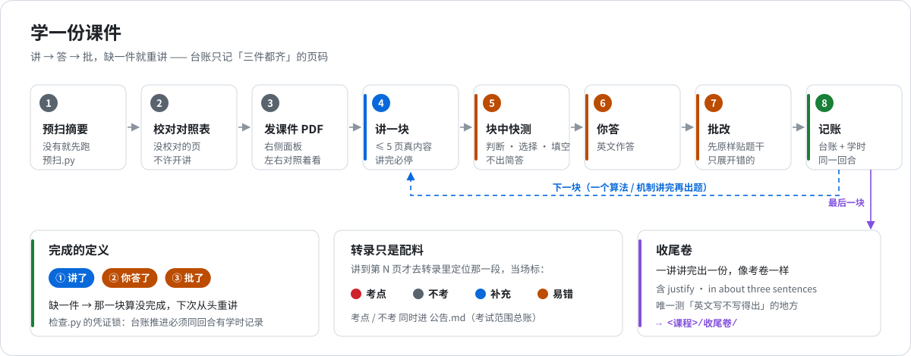
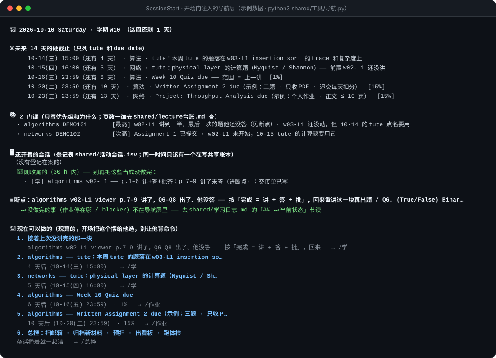
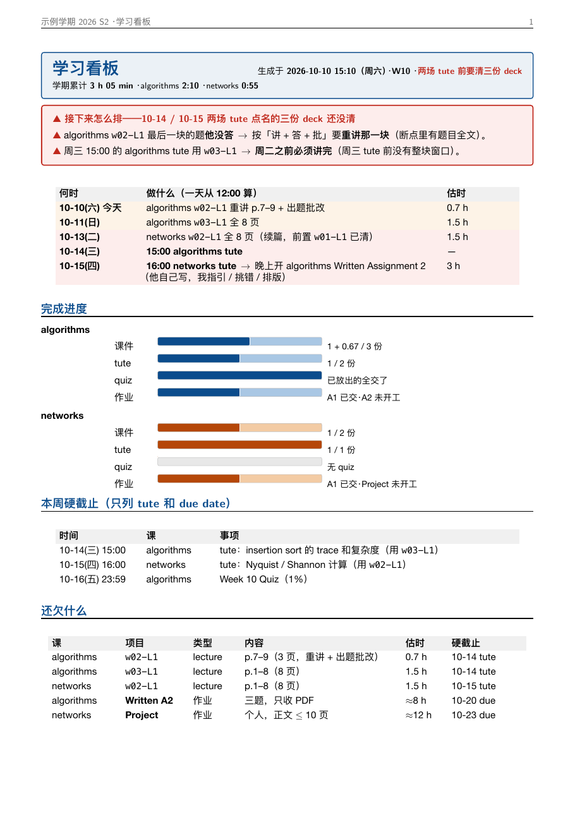
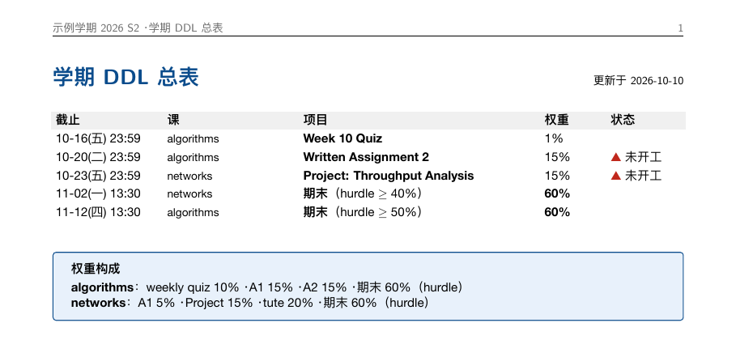

<div align="center">



<br>

[](LICENSE) [](https://claude.com/claude-code) [](#-requirements) [](#-consistency-checks) [](docs/接入其他模型.md) [](https://github.com/Zemmeng/claude-study-system/actions/workflows/smoke.yml)

[中文](README.md) · **English** · [Architecture (zh)](docs/架构说明.md) · [Customization guide (zh)](docs/自定义指南.md) · [Other LLMs (zh)](docs/接入其他模型.md)

</div>

---

A study harness that runs inside **Claude Code**. It is not a prompt collection. It is a **gated workflow**:

- Claude teaches your slides page by page. After each chunk it sets questions, you answer, it marks, and progress goes into a ledger.
- **Three hooks** step in at session start, on every message, and at the end of every turn. They turn "rules Claude should remember" into "rules that block the turn when broken".
- **Not tied to Claude**: point Claude Code at DeepSeek, Kimi or Zhipu GLM, or use the bundled `./study` runtime with any OpenAI-compatible model (OpenAI, Qwen, OpenRouter, local Ollama…).

> The author ran a full semester of a CS master's degree (four courses) on it. The [rule archive](shared/规则档案.md) records where each of its 53 rules came from.
> This is the **sanitized template**: no course materials, assignments or grades. The sample data is two made-up courses (`algorithms` / `networks`).

> [!NOTE]
> The rules, scripts, file names and diagrams are in **Chinese**. Claude reads them fine. If you want an English setup, ask Claude to translate `CLAUDE.md` and `.claude/commands/`, then run `检查.py`; check `[3]` flags every path you missed.

## ✨ Features

<table>
<tr>
<td width="33%" valign="top">

**🧭 One conversation, one job**

`/学` (study) teaches one deck, `/作业` (assignment) moves one assignment forward, `/总控` (control) does housekeeping. Claude opens with a menu, so there are no commands to memorise.

</td>
<td width="33%" valign="top">

**🔒 Three hooks enforce the rules**

Session start injects a nav layer; every message injects a must-do list; every turn ends with 14 consistency checks, and anything broken sends the turn back.

</td>
<td width="33%" valign="top">

**📒 Ledgers are the single source of truth**

Progress, deadlines, the current breakpoint and study hours live in `shared/` ledgers. New sessions read files, not memory.

</td>
</tr>
<tr>
<td valign="top">

**✅ Done = taught + answered + marked**

Chunks of at most 5 content slides, and Claude must stop after each one. Unless all three happen, the ledger may not advance (receipt lock).

</td>
<td valign="top">

**🎙️ Transcripts are an ingredient**

When teaching slide N, Claude looks up what the lecturer said about slide N. Examinable / not examinable / common mistakes get flagged on the spot.

</td>
<td valign="top">

**📊 One-command dashboard**

`/总控` builds two PDFs from scratch: what to do next, what's owed, progress bars, semester deadlines.

</td>
</tr>
</table>

## 🧱 Architecture

<p align="center"></p>

Three layers:

| Layer | Made of | Job |
|---|---|---|
| **Guard** | `.claude/settings.json` + `.claude/hooks/*.sh` | Inject context at fixed moments and block at end of turn. The only layer that doesn't rely on Claude's diligence |
| **Session** | `.claude/commands/*.md` + `CLAUDE.md` | Opening checklist, workflow, closing checklist and write permissions for each session type |
| **State** | `shared/` ledgers + `<course>/` directories | The only place facts live. Conversations forget; files don't |

Design principles:

1. **Rules live in files, not in conversation memory.** `CLAUDE.md` loads every session. The few rules that tend to get buried in long contexts are re-injected on every message.
2. **Every fact has exactly one home.** Page counts live only in the lecture ledger; everything else points there.
3. **If it can be checked mechanically, don't rely on discipline.** `检查.py` turns contradictions between ledgers into ❌, and the Stop hook blocks the turn.

## 🔄 Session lifecycle

<p align="center"></p>

| Hook | What it does | Blocks |
|---|---|:-:|
| **Session start**<br><sub>`SessionStart` · `inject-context.sh`</sub> | Injects a ~5 KB nav layer: week · upcoming hard deadlines · one line per course · breakpoint · today's reminders · health check | — |
| **Every message**<br><sub>`UserPromptSubmit` · `inject-time.sh`</sub> | Current time · check the transcript index before teaching · restate the question before marking · questions in English · new ❌ | — |
| **End of turn**<br><sub>`Stop` · `stop-check.sh`</sub> | Runs `检查.py`: any ❌ → `exit 2`; all green → action-item audit → `git commit` snapshot | ✅ |

## 📖 Studying one deck

<p align="center"></p>

During a chunk Claude sets only true/false, multiple choice and fill-in questions, which test *can you do it*. Short answers and justifications wait for the **end-of-lecture paper**, which tests *can you write the sentence that earns the marks in English*.

## 🔐 Write partitioning

<p align="center"></p>

Study and control sessions can run at the same time. Study sessions can't touch the shared ledgers, so they leave a handover note (`shared/交接/`), and `/总控` processes it first thing. No two sessions overwrite each other.

## 📸 What it looks like

<p align="center"></p>
<p align="center"><sub>The nav layer injected at session start (sample data). Claude builds the opening menu from the last section.</sub></p>

<table>
<tr>
<td width="55%" valign="top"><br><sub>Study dashboard from <code>/总控</code>: plan · progress · deadlines · what's owed</sub></td>
<td width="45%" valign="top"><br><sub>Semester deadline table with each course's weighting</sub></td>
</tr>
</table>

## 🚀 Quick start

```bash
git clone https://github.com/Zemmeng/claude-study-system.git
cd claude-study-system
python3 shared/工具/导航.py    # preview what the SessionStart hook injects
python3 shared/工具/检查.py    # run the consistency checker (should be all green)
claude                         # start Claude Code in the project root
```

**Adapting it to your semester:**

```bash
$EDITOR shared/配置.json                 # ① semester calendar + your courses
mkdir -p cs101/课件 && cp ~/Downloads/lec1.pdf cs101/课件/w01-L1.pdf   # ② optional: drop in slides you already have
python3 shared/工具/初始化.py            # ③ dry run
python3 shared/工具/初始化.py --apply    #    apply
```

`初始化.py --apply` (init) removes the two sample courses, creates a directory and `CLAUDE.md` template per course, generates blank ledgers (the week table is computed from the semester calendar in the config), registers and pre-scans any slides already in place, and runs the checker. Run it again whenever you get new slides or add a course: it only fills in what's missing and never overwrites existing content. Then edit the three ✏️ sections in `CLAUDE.md` and run `claude`.

The ledger format contracts are in the [customization guide](docs/自定义指南.md#4-账本格式契约).

> [!WARNING]
> **Your own copy will contain slides, recordings and assignments. Keep it private.** Slides and recordings are usually university copyright, and many courses forbid sharing assignment code.

## 🔌 Using other LLMs

Two routes, one shared `.env`:

```bash
cp .env.example .env      # set STUDY_PROVIDER (deepseek · kimi · glm · qwen · openai · openrouter · ollama …) and STUDY_API_KEY
```

| Route | Best for | Command |
|---|---|---|
| **A · Claude Code with another model** | Full feature set (subagents, MCP). Needs an Anthropic-compatible endpoint: DeepSeek · Kimi · Zhipu GLM | `python3 shared/工具/切换模型.py deepseek`, then `claude` |
| **B · Bundled runtime** | No Claude Code needed. **Any OpenAI-compatible API** | `./study` |

Both routes use the same rules, hooks and `/学` `/作业` `/总控` commands. The bundled runtime calls the same hook scripts using Claude Code's hook protocol, expands the same command files, and maps tools (`AskUserQuestion` → `ask_user`, `SendUserFile` → `open_file`). Details in [docs/接入其他模型.md](docs/接入其他模型.md).

## 🧰 Commands

| Command | What it does |
|---|---|
| `/学 <course> <deck>` | Study one deck: teach → quiz → you answer → mark → log → end-of-lecture paper |
| `/作业 <course> <id>` | One assignment: check *its own* AI policy, read the spec → guide / check / typeset → submit |
| `/总控` | Housekeeping and infrastructure: clear handover notes, then email, filing, pre-scan, transcription, dashboard, health check |
| `/next` | Build the study dashboard PDF (sub-flow of `/总控`) |
| `/week` | Weekly review and next week's plan |
| `/drill <course> <topic>` | Exam-style drilling for revision |
| `/预扫` | Pre-scan new slides: page count · footer offset · continuation deck? · animation frames · prerequisites |

## 🚦 Consistency checks

`shared/工具/检查.py` uses only the standard library and runs in about 0.1 s.

| # | Checks | Level |
|---|---|:-:|
| `[0]` | Core ledgers exist and are readable | 🔴 |
| `[1·语义]` | Log says "all clear" while the ledger still shows ❌ | 🔴 |
| `[2]` | No page numbers in the log's summary table (they belong in the ledger only) | 🔴 |
| `[3]` | Every path referenced in rule files exists | 🔴 |
| `[4]` | Study hours: grand total = per-course subtotals = sum of entries | 🔴 |
| `[7]` | Dashboard PDF is older than the ledgers | 🟡 |
| `[8]` | Ledger page count = real PDF page count (`pdfinfo`) | 🔴 |
| `[9]` | Transcripts marked "received" really exist on disk | 🔴 |
| `[10]` | Inbox is empty | 🟡 |
| `[11]` | Breakpoint section ≤ 40 lines | 🟡 |
| `[12]` | Handover notes have been processed | 🟡 |
| `[13]` | Rules changed in `CLAUDE.md` have been propagated downstream (paragraph hash) | 🔴 |
| `[14]` | Every unfinished deck has a pre-scan summary | 🟡 |
| `[G1]` `[G3]` | **Receipt locks**: ledger progress needs a study-hours entry in the same turn; unanswered questions in the breakpoint block marking those pages done | 🔴 |

<sub>🔴 = blocks the turn · 🟡 = warning only.</sub>

## 📦 Requirements

| Required | For |
|---|---|
| [Claude Code](https://claude.com/claude-code), **or** an API key for any OpenAI-compatible model | route A uses Claude Code; route B uses the bundled `./study` runtime |
| macOS or Linux | on Windows, use WSL |
| Python ≥ 3.9 | all scripts and hooks (stdlib only) |
| `git` | end-of-turn snapshots and receipt locks (no `user.name` needed; snapshots fall back to a local identity) |
| poppler (`pdfinfo` `pdftotext` `pdftoppm`) | page counts, pre-scans, rendering PDFs for visual checks |

| Optional | For |
|---|---|
| XeLaTeX | dashboard PDFs, typesetting assignments |
| whisper.cpp + ffmpeg | offline lecture transcription (`shared/工具/转录.sh`) |
| Gmail connector | email scan in `/总控` |
| Claude Code desktop app | session list (`list_sessions`) and sending PDFs to the side panel; skipped in the CLI |

## ❓ FAQ

<details>
<summary><b>Does it work with the CLI only?</b></summary>

Yes. Only two steps use desktop-only tools: the session list in `/总控` and sending PDFs to the side panel. In the CLI those steps are skipped and Claude reports file paths instead. The hooks and scripts don't depend on the desktop app.
</details>

<details>
<summary><b>Will it do my assignments for me?</b></summary>

That depends on the assignment's own spec. The academic-integrity section of `CLAUDE.md` has two lines. If the spec allows AI, use it within the allowed scope and declare it as required. If it doesn't, what you submit is produced by you, and Claude only explains concepts, points out which step is wrong, and checks formatting. The deciding document is always **that assignment's spec**, never another assignment's.
</details>

<details>
<summary><b>My course has no lecture recordings.</b></summary>

Mark the transcript column `➖不需要` and keep only the "other materials" section of each transcript index (textbook chapters, tutorial sheets). The "no teaching an unchecked slide" gate still applies, against whatever materials you have.
</details>

## 🌱 Background

The harness grew one rule at a time over a semester. In `1.x` a single conversation did everything and opened with **180 KB** of injected state. `2.0` switched to "one conversation, one job", with a **~5 KB** nav layer at session start and everything else fetched on demand. Why each rule was added, and the mistake that prompted it, is in [`shared/规则档案.md`](shared/规则档案.md).

## 📄 License

[MIT](LICENSE) © 2026 Zemmeng
