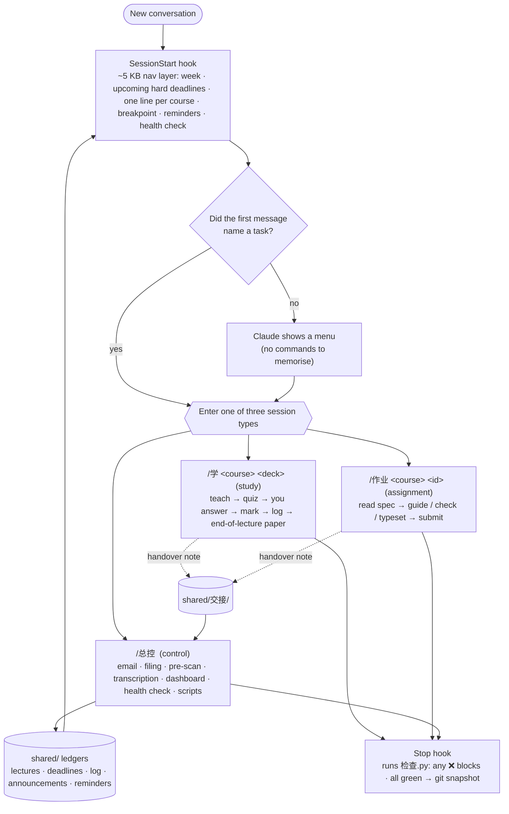

# claude-study-system

English · [中文](README.md)

> A study harness that makes Claude Code **walk you through lecture slides, page by page** —
> hooks + slash commands + a consistency checker + a `CLAUDE.md` that hard-codes the teaching rules.

The author used it for a full semester of a CS master's degree, across four courses: teaching slides, setting and marking questions, tracking deadlines, transcribing lectures, and generating a study dashboard.
**This is the sanitized template version** — no course materials, assignments or grades. The sample data is two made-up courses (`algorithms` / `networks`).

> 📝 The rules, scripts and file names are in **Chinese**. This page is the English overview. Claude reads Chinese fine; if you want an English setup, ask Claude to translate `CLAUDE.md` and `.claude/commands/` for you.

---

## What problem it solves

Common failure modes when Claude acts as a tutor, and how this harness handles them:

| Failure mode | Fix |
|---|---|
| Explains ten slides in one go and never checks you understood | Chunks of ≤ 5 content slides. **Done = explained + you answered + Claude marked it**; anything missing gets re-taught |
| Forgets where you were in a new conversation | Progress lives only in a ledger (`shared/lecture台账.md`), not in memory |
| Quotes deadlines or remaining pages from memory | Ledgers are the single source of truth; `导航.py` recomputes the week and upcoming deadlines every session |
| Agrees to a rule, forgets it next session | Rules live in `CLAUDE.md`; the critical ones are **enforced by a Stop hook** (any ❌ blocks the turn from ending) |
| One conversation does everything and the context bloats | **One conversation, one job**: study one deck / do one assignment / housekeeping |
| Dumps the lecture transcript on you | Transcripts are an *ingredient*: when teaching slide N, Claude looks up what the lecturer said about slide N and flags it inline |

In one line: **rules go in `CLAUDE.md`, state goes in ledgers, and hooks + scripts turn "Claude remembers" into "mechanically enforced".**

`shared/规则档案.md` (the rule archive) records **why each rule exists** — the student's own words, the mistakes Claude made, and what was done about them, newest first.

---

## Architecture



### Session types and write partitioning

| Type | Started with | May write |
|---|---|---|
| **Study** | `/学` · `/作业` | its own course directory · `shared/学时记录.md` (append only) · `shared/交接/` (handover notes, the only way back into the ledgers) |
| **Control** | `/总控` | the `shared/` ledgers · `.claude/` · `shared/工具/` · course directories |

Study and control sessions can run **at the same time**: study sessions can't touch the shared ledgers, so they leave handover notes, and `/总控` processes them first thing. No two sessions overwrite each other.

### Three hooks

| Hook | When | What | Can block? |
|---|---|---|---|
| `inject-context.sh` | session start | injects the nav layer (`导航.py`) + today's reminders + health summary | no |
| `inject-time.sh` | every message | current time + must-dos before teaching / marking | no |
| `stop-check.sh` | end of every turn | runs `检查.py`; any ❌ blocks; all green → action-item audit → git snapshot | ✅ |

`检查.py` checks consistency across the ledgers: recorded page counts vs real PDF page counts, total study hours vs the sum of entries, whether referenced paths exist, whether handover notes are cleared, plus two **receipt locks** (ledger progress may only advance in a turn where explain + answer + mark all happened).

### Studying one deck

```
pre-scan summary (run 预扫.py if missing) → check the transcript index (no teaching an unchecked slide)
→ open the PDF in the side panel → teach a chunk (≤ 5 slides) → quick objective questions, options labelled (a)(b)(c)(d)
→ you answer → marking (question restated first) → log progress → … → end-of-lecture exam-style paper
```

Anything the lecturer said that isn't on the slides is flagged on that slide: 🔴 examinable · ⚪ not examinable · 💡 extra · ⚠️ common mistake.

---

## Quick start

```bash
git clone https://github.com/Zemmeng/claude-study-system.git
cd claude-study-system
python3 shared/工具/导航.py      # preview what the SessionStart hook injects
python3 shared/工具/检查.py      # run the consistency checker
claude                           # start Claude Code here
```

### Adapting it to your semester

1. **Edit `shared/配置.json`** — course key (also the directory name), code, name, aliases, lecture / tutorial times. Every script reads the course list from here.
2. **Create course directories** following the sample layout (`<course>/课件/ 字幕/ 笔记/ 作业/ …`) and delete `algorithms/` and `networks/`. Slides are named `wNN-LN.pdf`.
3. **Clear the sample rows in the `shared/` ledgers** (keep headers and top notes); replace the calendar in `deadlines.md`.
4. **Edit the three "about the student" sections in `CLAUDE.md`** (marked ✏️). "他" (he) in the files refers to the student.
5. Run `python3 shared/工具/检查.py` until it's green, then `claude`.

> ⚠️ **Your own copy will contain slides, recordings and assignments — keep it private.** Slides and recordings are usually university copyright, and many courses forbid sharing assignment code.

---

## Requirements

| Required | For |
|---|---|
| [Claude Code](https://claude.com/claude-code) | — |
| Python ≥ 3.9 | all scripts (stdlib only) |
| `jq` | building the SessionStart JSON |
| `git` | Stop-hook snapshots and receipt locks |
| poppler (`pdfinfo` `pdftotext` `pdftoppm`) | page counts, pre-scans, rendering PDFs for visual checks |

| Optional | For |
|---|---|
| XeLaTeX | dashboard PDF, typesetting assignments |
| whisper.cpp + ffmpeg | offline lecture transcription (`shared/工具/转录.sh`) |
| Gmail connector | email scan in `/总控` |
| Claude Code desktop app | `对齐.py` reads other sessions' transcripts; skipped in the CLI |

---

## Known limitations

- Everything is in Chinese, including file names (scripts are fine; your terminal needs UTF-8).
- `检查.py` parses the ledgers with regexes written for this exact format; change the format, change the script.
- It was built for one person and many rules carry his habits (gets up at noon, exams in English, usually skips lectures). Treat them as examples.
- **It does not help you get around a course's AI policy.** The rule in `CLAUDE.md`: each assignment follows its own spec; when AI isn't allowed, what you submit is written by you.

## License

[MIT](LICENSE)
