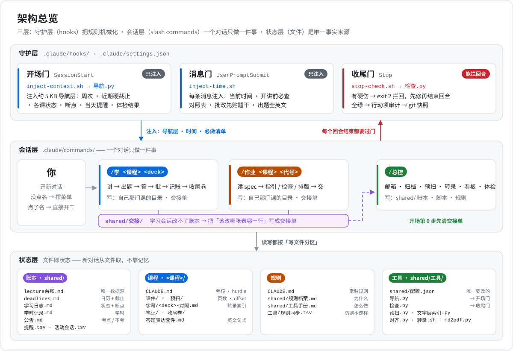
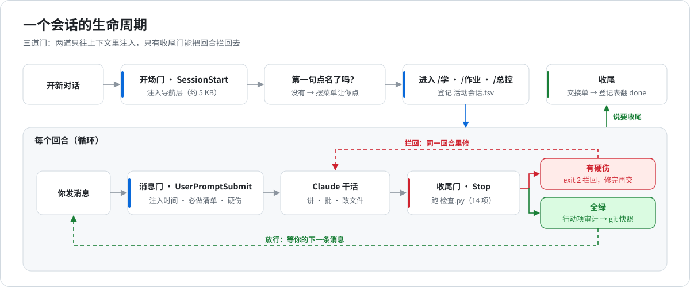
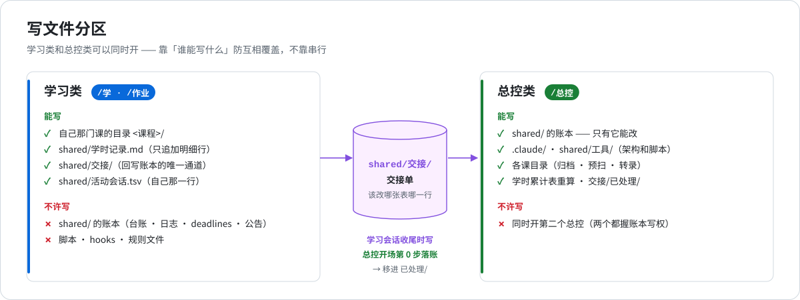

# 架构说明

> 这份文档讲 **claude-study-system 由哪些部件组成、它们之间的契约是什么、为什么这么设计**。
> 想直接上手换成自己的课，看 [自定义指南](自定义指南.md)；想知道某条规则的来历，看 [`shared/规则档案.md`](../shared/规则档案.md)。

- [1. 设计目标](#1-设计目标)
- [2. 三层架构](#2-三层架构)
- [3. 守护层：三道门](#3-守护层三道门)
- [4. 会话层：三类会话](#4-会话层三类会话)
- [5. 状态层：账本与课程目录](#5-状态层账本与课程目录)
- [6. 一致性检查与凭证锁](#6-一致性检查与凭证锁)
- [7. 规则的三种存放方式](#7-规则的三种存放方式)
- [8. 多 agent 任务的规矩](#8-多-agent-任务的规矩)
- [9. 部署与验证](#9-部署与验证)
- [演进](#演进)
- [已知限制](#已知限制)

---

## 1. 设计目标

| 目标 | 具体指什么 |
|---|---|
| **学习不断线** | 换对话、隔几天、被打断，回来都能从准确的位置接上，不重讲已经会的，也不漏掉没验证的 |
| **验证而不是讲完** | 「讲了」不算学完；必须他答、Claude 批，三件齐了才算 |
| **规则执行稳定** | 规则不是不存在，而是被打断之后执行不稳定。能机械检查的一律交给脚本和 hook |
| **基建不占注意力** | 文件一致性是 Claude 的活。学习回合里，基建话题一次不超过一行 |

**非目标：** 不做通用笔记软件，不做题库，也不替学生完成计分作业（见 `CLAUDE.md` 学术诚信节）。

## 2. 三层架构

<p align="center"></p>

| 层 | 由什么组成 | 职责 |
|---|---|---|
| **守护层** | `.claude/settings.json` + `.claude/hooks/*.sh` | 在固定时刻注入上下文、在回合结束时拦截。**唯一不依赖 Claude 自觉的一层** |
| **会话层** | `.claude/commands/*.md` + `CLAUDE.md` | 定义三类会话各自的开场清单、工作流程、收尾清单和写权限 |
| **状态层** | `shared/` 的账本 + `<课程>/` 目录 | 所有事实的唯一存放处。对话结束即失忆，文件不会 |

数据流只有两条：

1. **读路径**：账本 → `导航.py` 现算 → 开场门注入 → Claude 据此摆菜单、排计划
2. **写路径**：学习会话 → 交接单 → `/总控` 落账 → 账本；每个回合结束，`检查.py` 核对一遍，全绿才放行并快照

## 3. 守护层：三道门

<p align="center"></p>

| | 开场门 | 消息门 | 收尾门 |
|---|---|---|---|
| **事件** | `SessionStart` | `UserPromptSubmit` | `Stop` |
| **脚本** | `inject-context.sh` | `inject-time.sh` | `stop-check.sh` |
| **超时** | 20 s | 10 s | 150 s |
| **输入** | — | — | stdin JSON（读 `stop_hook_active`）|
| **输出** | `additionalContext`（JSON，python3 拼）| `additionalContext`（JSON）| stderr 文本 + 退出码 |
| **退出码** | 恒 0 | 恒 0 | `0` 放行 · `2` 拦回 |
| **注入 / 做什么** | `导航.py` 的导航层 + 当天提醒 + 邮箱简报是否到期 + `检查.py` 摘要 | 当前时间 · 开讲前必查对照表 · 批改先贴题干 · 出题全英文 · 新出现的 ❌ | 跑 `检查.py` → 行动项审计 → `git commit` |

### 为什么分三道

- **开场门只响一次。** 开场注入的信息，十几轮之后就会被埋在长上下文里。所以必须**每条都生效**的规则（时间、批改先贴题干、出题语言）放进消息门。原项目实测：只有每条消息都响的 hook，隔多久都不失效。
- **只有收尾门能拦。** 前两道门只能「提醒」，收尾门用 `exit 2` 把回合打回去，Claude 必须先修再结束。

### 收尾门的三个细节

| 细节 | 怎么做 | 为什么 |
|---|---|---|
| **防死循环** | `stop_hook_active=true` 时直接放行 | 修不掉的问题（缺文件、要问用户）在回复里明说，下一次放行，不无限拦 |
| **别的会话的半成品** | ❌ 全部出在 `shared/` 账本上，且本回合 `git diff HEAD` 没碰过那些文件 → 放行 | 多个会话共用一个工作树，学习会话无权去修总控的账本，拦了只会卡死 |
| **自动快照** | 全绿 → `git add -A && git commit -m "turn: <时间>"` | 凭证锁靠 `HEAD` 判断「本回合改了什么」。用 `[ -e .git ]` 不用 `[ -d .git ]`：在 worktree 里 `.git` 是个文件，写成 `-d` 会让快照在所有 worktree 里静默失效（原项目真出过事）|

### 开场门的降级

`检查.py` 自己崩溃时，输出里既没有 ❌ 也没有 ⚠️。如果只按这两个符号判断，就会显示「全绿」。开场门改用「输出里有没有『汇总』那一节」判断脚本有没有跑完，没跑完就显式报 🔴🔴，而不是**门禁失效还伪装成全绿**。

## 4. 会话层：三类会话

| 类 | 命令 | 开场必读 | 只许写 | 收尾 |
|---|---|---|---|---|
| **学习** | `/学 <课程> <deck>` | 那门课的 `CLAUDE.md` · 台账那几行 · 那份 deck 的预扫和对照表 · 断点 | 自己那门课的目录 · `学时记录.md` 追加 · `交接/` · 登记表自己那行 | 写交接单 · 登记表翻 `done` |
| **作业** | `/作业 <课程> <代号>` | 那份作业的 spec / 要点 · **它自己的 AI 条款** · `deadlines.md` 那一行 | 同上 | 同上 |
| **总控** | `/总控` | 交接单 · 登记表 · `对齐.py` 的输出 · 账本 | `shared/` 账本 · `.claude/` · `shared/工具/` · 各课目录 | 全套一致性核对 |

<p align="center"></p>

### 开场：摆菜单

学生第一句没说要干什么时，Claude 用 `AskUserQuestion` 把导航层算出的「现在可以做的」前 3 条 + 「总控」摆成选项。学生点名了就直接开工。**不让学生记命令语法。**

### 交接单协议

学习会话写不了账本，就把「该改哪张表的哪一行」写成交接单。交接单固定四节，定义在 [`shared/交接/README.md`](../shared/交接/README.md)：

| 节 | 放什么 |
|---|---|
| `## 1. 事实` | 交了没有 · 讲到第几页（viewer 页）· 完成度 |
| `## 2. 该改哪张表的哪一行` | 带行号，写「现在写着什么 → 实际是什么」 |
| `## 3. 留给 /总控` | 学习中撞见、但不该当场做的杂活 |
| `## 4. 还没并的过程细节` | 可选 |

`/总控` 开场第 0 步逐条落账，然后把交接单 `mv` 进 `已处理/`。`检查.py [12]` 盯着这个目录必须清空。

### 登记表

`shared/活动会话.tsv` 记录每个会话的开始时间、类型、在做什么、状态（`active` / `done`）。导航层据此显示「还开着的会话」和「30 小时内刚收尾的」，防止把已经做完的事又排成待办。

## 5. 状态层：账本与课程目录

| 文件 | 唯一负责 | 谁读 | 谁写 |
|---|---|---|---|
| `lecture台账.md` | 每份 deck 的页数 · 讲到哪 · 字幕 · 到场 | 导航 · 检查 · `/学` · `/next` | `/总控` |
| `deadlines.md` | 学期日历 · 时间线 | 导航 · `/next` · `/作业` | `/总控` |
| `学习日志.md` | 当前状态 · 断点 · 反复犯的错 · 历史流水 | 导航 · 检查 · 所有会话 | `/总控` |
| `学时记录.md` | 学时明细 · 各科小计 · 累计 | 检查 · `/next` | 学习会话追加明细，`/总控` 重算累计 |
| `公告.md` | 课件之外的信息：考点 · 不考 · 公告 | `/学` · `/next` | `/总控` |
| `提醒.tsv` | 日期触发的提醒 | 开场门（`提醒.py`）| `/总控` |
| `活动会话.tsv` | 会话登记 | 导航 | 每个会话写自己那行 |
| `<课程>/课件/_预扫/<deck>.md` | 页数 · 页脚 offset · 续篇判定 · 动画帧 · 前置警告 | `/学` · `/next` · 检查 `[14]` | `预扫.py --save` |
| `<课程>/字幕/<deck>-对照.md` | 按课件页码切的转录索引 + 「📗 其他资料对应段落」 | `/学`（开讲前必查）| `/学` · `/总控` |

**单一出处原则**：页数只在台账，学习日志的速查表里一个页码都不许出现（`[2]` 盯着）。速查表只写「优先级和为什么」。原项目三次报错都是同一个原因：一处更新了，另一处的副本没跟上。

## 6. 一致性检查与凭证锁

`检查.py` 共 14 项，完整列表见 [README](../README.md#-一致性检查)。设计上有三点值得一提：

**① 每项都有兜底。** 每项检查都包在 `run()` 里，单项异常会变成一条 ❌（带行号），不会让整个脚本崩掉，后面的项照样跑完。

**② 凭证锁 `[G1]` `[G3]`。**

| 锁 | 判据 | 防的是什么 |
|---|---|---|
| `[G1]` 台账推进锁 | 某 deck 的「讲到」列升级了（❌ → 部分 → 全），但同一回合 `学时记录.md` 没有新增那份 deck 的明细行 → ❌ | 「讲完了就记进度」—— 他没答题也记成学完 |
| `[G3]` 重讲锁 | 断点里挂着「没答」的块，同一回合却把台账推进到那几页 → ❌ | 「题没答完先记账」 |

两把锁都用 `git diff HEAD` 判断「本回合改了什么」，所以依赖收尾门每次全绿后的自动快照。

**③ 机械检查的边界写在输出里。** 汇总节末尾会明确列出脚本**盖不住**的两项：学习日志上半部分的语义过期句、台账「讲到」列本身记得对不对。原项目曾有一项检查一直输出「✅ 一致（比对了 0 处）」，是个假绿灯，删掉之后就把「这一层只能靠人工」写死在输出里，免得被误以为有机械保障。

## 7. 规则的三种存放方式

| 放哪 | 什么规则 | 失效方式 |
|---|---|---|
| `CLAUDE.md` | 全部规则的正本，每个会话自动加载 | 会被埋在长上下文里 |
| `.claude/commands/*.md` | 某类会话必须照做的步骤 | 和正本走样 |
| `inject-time.sh` | 必须每条消息都生效的少数几条 | 占每条消息的注入预算，只放最要命的 |

为了防止「同一条规则在 N 个文件里各有一份副本，副本之间没有机械联系」，用 [`shared/工具/规则同步.tsv`](../shared/工具/规则同步.tsv) 登记每条需要下游落实的规则：

```
key	主文件锚点(正则)	依赖文件	依赖文件里的落地痕迹(正则)	主文件段落哈希	说明
```

`检查.py [13]` 每回合检查三件事：主文件里那条规则还在不在；每个依赖文件里还能不能找到它的落地痕迹；主文件那一段的哈希变了没有。哈希变了就是 ⚠️，提醒去核下游要不要跟着改，核完把新哈希写回表里。

## 8. 多 agent 任务的规矩

| 规矩 | 为什么 |
|---|---|
| 超过 10 个 agent 先问，改成「预约制」，学生不学习时再跑 | token 配额是共享的，大任务会让正在学习的对话当场断掉 |
| 大规模扇出的 agent 一律用较小的模型，主模型只留给 1–2 个判官 | 同上 |
| 每个 agent **先把结果写进 `shared/审计/<维度>.md` 再返回** | 撞限额时成果不丢；续跑时 agent 先看文件在不在，在就直接读出来当结果，不重跑 |

## 9. 部署与验证

| 部件 | 做什么 |
|---|---|
| `shared/配置.json` + `配置.py` | 课程列表和学期日历的唯一出处，所有脚本从这里读 |
| `shared/工具/初始化.py` | 示例 → 你的学期：删示例课、建目录、生成空白账本、登记已有课件并预扫。**幂等**：带「示例数据」标记的账本才重置，你自己的数据只补不删 |
| `tests/smoke.sh` | 模拟新用户从 clone 到部署的 16 项冒烟测试 |
| `.github/workflows/smoke.yml` | 每次推送在 Ubuntu（Python 3.9 / 3.12）和 macOS 上跑冒烟测试 |

可移植性上的几个决定：

- **hook 只依赖 bash + python3。** JSON 由 python3 拼，不依赖 `jq`。缺 poppler 时 `[8]` 降级为提示并给出安装命令。
- **规则文件里的 `~/` 路径不做存在性检查。** Downloads、Zotero、TeX 的位置因机器而异，不归仓库管。
- **快照不依赖 git 身份。** 没配 `user.name` 的机器上，收尾门用一个只在本仓库生效的兜底身份提交，凭证锁照常工作。
- **学期可以跨年。** 周表只写 `MM-DD`，导航层按周号顺序推年份；截止日期取离学期最近的那一年。

## 演进

| 日期 | 版本 / 事件 | 改了什么 |
|---|---|---|
| 08-04 | 学习流程定死 | 课件是主线，转录只是配料；讲到第 N 页才去对照那一段 |
| 08-06 | 完成的定义 | 完成 = 讲 + 答 + 批，缺一件就重讲 |
| 08-13 | 提醒与体检 | `提醒.tsv` 接管日期触发；消息门开始报一致性硬伤 |
| 08-14 | 收尾门 | Stop hook + `检查.py`：有 ❌ 不许结束回合 |
| 08-15 | git 化 + 凭证锁 | 每个全绿回合自动快照；`[G1]` `[G3]` 上线 |
| 08-16 | 题型分层 | 块中快测、收尾卷深测，不再每块都出简答 |
| 08-21 | 预扫 | 新课件到手先机械扫一遍：offset · 续篇 · 动画帧 · 前置链 |
| 08-29 | 讲解形态 | 一页 = 一个小标题 + 最多两件东西；表格 / ✅❌ 对照 / 代码标注 |
| **09-01** | **2.0** | **一个对话只做一件事**；开场注入从 180 KB 降到约 5 KB 导航层 |
| 09-02 | 会话并行 | 「同一时间只开一个会话」作废，改成写文件分区 |
| 09-03 | 架构审计 | 交接单成为常设通道；`规则同步.tsv` + `[13]`；`对齐.py` 读其他对话的 transcript |
| 09-13 | 规模与政策 | subagent 超过 10 个改预约制；学术诚信改成按每份作业的 spec 分两条线 |

每一行背后的原话和事故经过，在 [`shared/规则档案.md`](../shared/规则档案.md) 里按日期倒序可查。

## 已知限制

- **语义层靠人工。** 学习日志里的过期句、台账「讲到」列本身记错了，脚本都看不出来。
- **格式即契约。** `检查.py` 和 `导航.py` 用正则解析账本，改格式必须同步改脚本（见[自定义指南 · 账本格式契约](自定义指南.md#4-账本格式契约)）。
- **单人设计。** 很多规则带着原作者的习惯（中午起床、考卷是英文、默认不去 lecture），当成例子看。
- **登记表靠自觉。** `活动会话.tsv` 是会话自己登记的，不是实时探测；桌面版里总控可以用 `list_sessions` 再核一遍。
